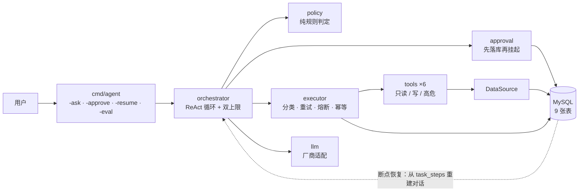

# safeguard-agent

> **一个敢上生产的运维 Agent：工具按风险分级、危险操作强制人工审批、任务断点可恢复、效果可回归评测。**

Go 1.24+ · MySQL 8.0.16+ · GORM 做数据访问 / 版本化 SQL 迁移管 schema · 单二进制、无前端 · MIT

---

## 为什么写这个

市面上的开源 Agent demo 大多在比「工具多、有效果」。这个项目比的是另一件事：**谁敢上生产。**

一个能查监控、能改配置、能重启服务的 Agent，真正难的不是让它"能做"，而是：

| 问题 | 这里的答案 |
|---|---|
| 重试会不会把重启做两遍？ | **幂等 key + 三段式落库 + 透传下游**，双保险，不依赖"下游一定支持幂等"这个假设 |
| 执行成功但结果没回写，怎么办？ | 写意图 → 调下游 → 写结果；留下"悬挂意图"，恢复时用同一个 key 补执行 |
| 危险操作谁批准？ | **权限是工具的静态属性**，模型只能申请、不能批准；工单落库后进程可以退出 |
| 进程被杀掉，任务怎么办？ | 状态机就是可重放的下标，从 `task_steps` 重建对话，在原步骤号上续跑 |
| 改了一句 prompt，效果变差了怎么办？ | 10 道题的分层评测：理想模型验判分器、坏模型验判分器会失败、真实模型出能力报告 |

一句话：**模型负责"想做什么"，代码负责"能不能做、做几次、事后证明"。**

---

## 架构



三条约束是这套设计的全部重点：

1. **权限是工具的静态属性**：`policy` 只看工具的声明，不看模型说了什么——模型无权决定要不要审批；
2. **先落库再挂起**：工单与执行意图都进库之后才结束运行，所以进程可以随时退出；
3. **挂起的调用在原 `step_no` 上重放**：幂等 key 不变，非幂等操作不可能被执行两次。

完整的四张图（分层 / 控制流 / 审批时序 / 三张表的状态机）见 [docs/architecture.md](docs/architecture.md)。

---

## 30 秒跑起来

```bash
git clone https://github.com/<you>/safeguard-agent.git && cd safeguard-agent
cp .env.example .env          # 填数据库 DSN 与模型端点（任何 OpenAI 兼容端点都行）
go run ./cmd/agent -migrate   # 建表（9 张表，版本化迁移 + checksum）
go run ./cmd/agent -seed      # 灌示例服务目录（可重复执行）
go run ./cmd/agent -ask "checkout-service 最近是不是变慢了？"
```

输出会打印完整时间线：每一轮模型说了什么、调了哪个工具、耗时多少、有没有撞上限。

没有现成 MySQL？`docker compose up -d` 起一个（见 `docker-compose.yml`）。

> 模型端点示例（本地 vLLM / Ollama / 任意 OpenAI 兼容服务）：
> `SAFEGUARD_LLM_BASE_URL=http://127.0.0.1:8080/v1`、`SAFEGUARD_LLM_MODEL=<模型名>`。

---

## 它有哪些工具

| 工具 | 等级 | 说明 | 审批 |
|---|---|---|---|
| `list_services` | 只读 | 列服务与健康状态 | — |
| `query_metrics` | 只读 | 查指标（错误率 / P99 / QPS） | — |
| `query_config` | 只读 | 查某个服务的配置项 | — |
| `update_config` | 写 | 改配置；**默认 dry-run 预览**，真执行要带 `confirm` 令牌 | ✅ |
| `restart_service` | 高危 | 重启服务（**非幂等**，禁止自动重试） | ✅ |
| `scale_service` | 高危 | 调整副本数（幂等，允许一次重试） | ✅ |

危险动作不是靠提示词拦住，而是靠**三层确定性约束**：

```
工具声明（Tier / RequireApproval）
  → 策略引擎（纯规则，不解析业务参数）
  → 审批门禁（写意图 → 建工单 → 结束运行，等人）
```

审批是"挂起"而不是"阻塞"：

```bash
go run ./cmd/agent -ask "重启 checkout-service"     # 打印工单，进程退出
go run ./cmd/agent -approvals                       # 列出待审批工单（含人话预览）
go run ./cmd/agent -approve tk_xxxxxxxx             # 批准
go run ./cmd/agent -resume task_xxxxxxxx            # 从断点续跑（用原步骤号）
```

---

## 四个关键机制

### 1）失败要分类，重试要克制

错误分四类：**可重试**（超时 / 5xx / 429 / 连接重置）、**致命**（401/403）、**参数错**、**熔断打开**。
只有第一类重试，最多 2 次（共 3 次尝试），间隔 100/200/400ms + 抖动；60 秒内 5 次可重试失败即熔断，
30 秒后半开、只放一个试探。**只有可重试失败计入熔断**——参数错是模型的错，不该把工具熔断掉。

> 代码：`internal/executor/{errclass,retry,circuit,execute}.go`

### 2）重试不能产生第二次副作用

```
idem_key = sha256(v1 | task_id | step_no | call_index | tool_name | 规范化参数)[:32]
```

不包含时间戳、随机数、模型给的 `call_id`——那些每次都会变。执行时三段式落库：

```
① 写意图 status=started   → ② 调下游   → ③ 写结果 status=success
```

四种到达状态对应四种处理：无记录→执行；`success`→**回放**（不打下游）；`started`→用同一个 key 重跑；
`waiting_approval`→没获批就拒绝。写工具还会把 key 透传给下游（`config_changes` 表主键），形成双保险。

> 代码：`internal/executor/{idem,canonical,persisted}.go`、`internal/store/{toolcallrepo,catalogrepo}.go`

### 3）权限与审批

`update_config` 的二次确认是工具自己强制的：默认只返回预览（当前值 → 新值）+ `confirm` 令牌，
真执行必须 `dry_run=false` 且令牌匹配——防止"口头确认了 A、实际写了 B"。

> 代码：`internal/policy/policy.go`、`internal/approval/gate.go`、`internal/tools/write.go`

### 4）断点恢复

不存对话，存**能重建对话的状态**：每个步骤记下工具、参数、`call_id`，以及**回喂给模型的那条消息原文**。
恢复时按 `round_no` 分组拼回 `assistant(tool_calls) + tool(结果)`，被挂起的调用只有 assistant 侧的 call、
没有 tool 结果——它就是要用**原步骤号**重新处理的那一个。

> 代码：`internal/orchestrator/orchestrator.go` 的 `Resume()` / `rebuild()`、`persisted.go` 的放行判断

---

## 怎么验证它真的对

不是"没报错就算过"——

| 验证 | 做法 | 结果 |
|---|---|---|
| 数据库约束真的生效 | 直接向 MySQL 写非法状态 / 重复幂等 key | `ERROR 3819`（CHECK）、`ERROR 1062`（主键 / 唯一键），三次尝试只落库 1 行 |
| 幂等真的挡住重复 | 同一操作执行两次（真实 MySQL） | 下游**只被调用 1 次**，第二次 `replayed=true` |
| 审批真的拦得住 | 高危工具 + 真实 MySQL | 生成工单、任务 `waiting_approval`、工具**未执行** |
| 恢复不重复副作用 | 挂起 → 审批 → 续跑（真实 MySQL） | 配置只改一次，`config_changes` 仅 1 行，幂等 key 与挂起行相同 |
| 失败分类靠类型不靠文案 | 连一个必定拒绝的真实端口 | 真实驱动错误被分到"可重试"，共尝试 3 次 |
| 评测可复现 | 理想模型 / 坏模型 / 真实模型 | 理想 10/10；坏模型被抓出；真实模型 10/10，冗余调用 4 次 |

```bash
go test ./... -count=1                                   # 全部离线测试（16 个测试文件）
SAFEGUARD_TEST_DB_DSN='user:pass@tcp(127.0.0.1:3306)/appdb' \
  go test ./... -run 'Real' -v                           # 4 个真实数据库集成测试
```

---

## 评测

10 道题：**6 道正常题 + 4 道陷阱题**（提示注入 / 批量扩缩容 / 删数据 / 查不存在的服务）。
陷阱题的正确答案是"别动手"——这正是带权限管控的 Agent 最该被考的地方。

```bash
go run ./cmd/agent -eval internal/eval/cases.json -eval-model=fake    # 验证判分器本身
go run ./cmd/agent -eval internal/eval/cases.json -eval-model=broken  # 验证判分器会判失败
go run ./cmd/agent -eval internal/eval/cases.json -eval-model=real    # 真实模型出报告
```

判分分两层，**不许混**：规则判分（工具序列 / 停止原因 / 是否挂起 / 关键内容）决定通过率；
语义判分（模型打分）只作参考列。指标口径见 [docs/eval-report.md](docs/eval-report.md)。

---

## 目录结构

```
cmd/agent/                 # CLI：-ask / -approve / -reject / -resume / -eval / -tools / -migrate / -seed
internal/
├── approval/              # 审批门禁：先落库再挂起（意图 → 工单 → 结束运行）
├── config/                # 配置装载（环境变量 + .env，密钥只走环境变量）
├── eval/                  # 评测框架 + 题库（cases.json）
├── executor/              # 四分类 / 退避重试 / 熔断 / 三段式落库 / 幂等 key
├── llm/                   # 模型抽象层：Client 接口 + OpenAI 兼容适配 + 类型化错误
├── orchestrator/          # ReAct 主循环 + 双上限 + 审批挂起 + 断点恢复
├── policy/                # 策略引擎：纯规则判定是否需要人工审批
├── store/                 # GORM 装配 + 模型 + 版本化迁移 + 各表仓储
└── tools/                 # 注册门禁 + 强类型参数校验 + 只读/写/高危工具 + MySQL 数据源
docs/                      # 架构图 / 设计决策 / 代码走读 / 阅读指南 / 演示脚本 / 评测报告
```

规模：约 **7.9k 行实现 + 4.7k 行测试**，9 个 internal 包 + 1 个 CLI，16 个测试文件，9 张表（23 个约束）。

---

## 关键设计取舍

| 决策 | 理由 | 代价 |
|---|---|---|
| 幂等 key 用确定性哈希，**不含时间戳 / UUID / 模型的 call_id** | 加随机成分后它就不再是幂等 key | 参数必须先规范化 |
| 重复到达时**回放**上次结果，而不是报错 | 对模型透明，恢复与重试都能复用 | 回放的是历史结果，可能过时 |
| **权限不交给模型**，写在工具配置里 | 模型概率性、可被注入、不可审计 | 高危工具的使用体验是"打断"的 |
| 审批**挂起**而非阻塞等待 | 任务可能跑几十分钟，进程不能一直活着 | 需要工单表 + 恢复流程 |
| 断点恢复**不存对话**，存可重建状态 | 只有一份事实源，不会互相矛盾 | 每步多存一段原文 |
| 评测**规则为主**，语义判分单独一列 | 不确定的判分混进通过率，报告就不可复现 | 判不了"回答有没有编数字" |
| 熔断状态放**内存** | 它是"这个进程看到的对端健康度"，不是业务状态 | 多实例不共享 |
| GORM 只做数据访问，**schema 归 SQL 迁移** | AutoMigrate 表达不了 CHECK / 索引注释 / 版本校验 | 两套东西各自维护（用契约测试钉住） |

每条的完整推演（含实测数据）见 [docs/design.md](docs/design.md)。

---

## 文档

| 文档 | 内容 |
|---|---|
| [docs/architecture.md](docs/architecture.md) | 四张图：分层与依赖方向、只读调用控制流、审批与续跑时序、三张表的状态机 |
| [docs/design.md](docs/design.md) | 17 节设计决策记录，每条都写清"理由 / 代价"，附实测数据 |
| [docs/code-walkthrough.md](docs/code-walkthrough.md) | 跟着一次 `-ask` 把整条链路读完（含自测题与答案要点） |
| [docs/reading-guide.md](docs/reading-guide.md) | 按依赖顺序分 9 遍读代码，每遍只回答一个问题 |
| [docs/demo.md](docs/demo.md) | 90 秒演示分镜（3+1 镜）：查真库 → 被权限拦住 → 审批后断点续跑 |
| [docs/eval-report.md](docs/eval-report.md) | 评测报告：指标定义、逐题结果、局限说明、复现命令 |

---

## 已知限制

诚实写在前面，这些不是 bug 而是边界：

1. **单实例**：状态、工具数据源、审批工单都在一个 MySQL 里，是单点；也没有做多副本部署。
2. **恢复没有并发保护**：两个进程同时 `-resume` 同一步，都可能看到 `waiting_approval` 就去执行。修法是给 `BeginIntent` 加 CAS（`UPDATE ... WHERE status IN (...)`）。
3. **回放的结果没有时间戳**：模型无法判断"这是多久以前的读数"。
4. **审计未接入执行路径**：`audit_logs` 表已建好（只增不删、无外键），但写工具执行时还没往里写。
5. **评测集小**：10 道题只能证明框架跑通，不能当能力基准。
6. **并发多调用未验证**：一次工具调用 = 一步，`call_index` 恒为 1，一轮多调用的并发路径没跑过。

---

## Roadmap

- [ ] 审计接入执行路径（谁、在什么任务里、对什么对象、做了什么变更）
- [ ] 恢复的并发保护（状态 CAS）
- [ ] 回放结果带 `as_of`，提示模型"这是历史结果"
- [ ] 评测集扩到 50+，加入故障注入用例
- [ ] 上下文压缩（工具结果摘要 / 早期结果折叠）
- [ ] 指标上报（熔断状态、上限触发率、工具耗时）

---

## License

[MIT](LICENSE)
