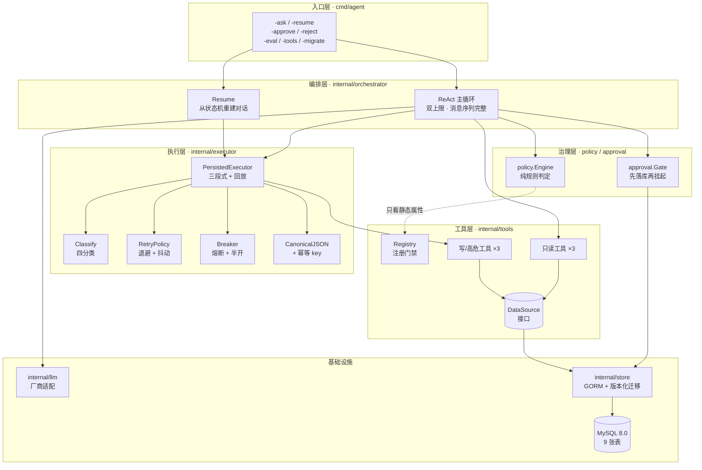
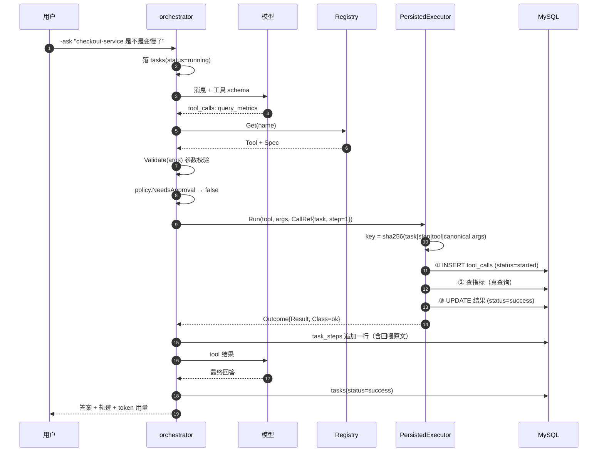
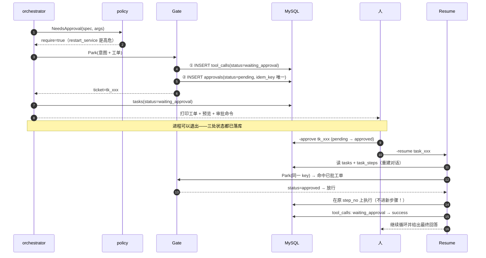
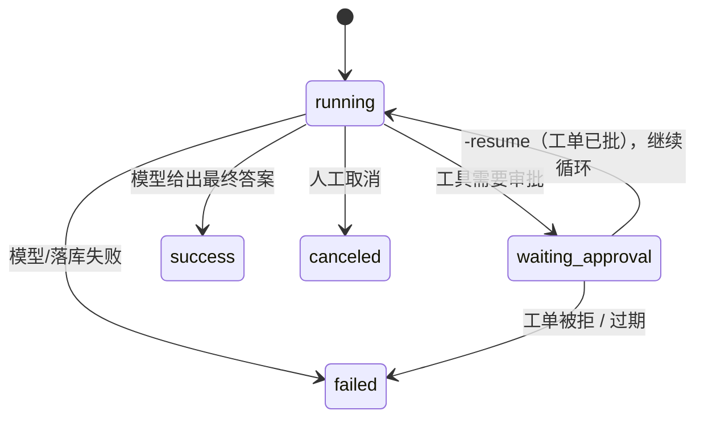
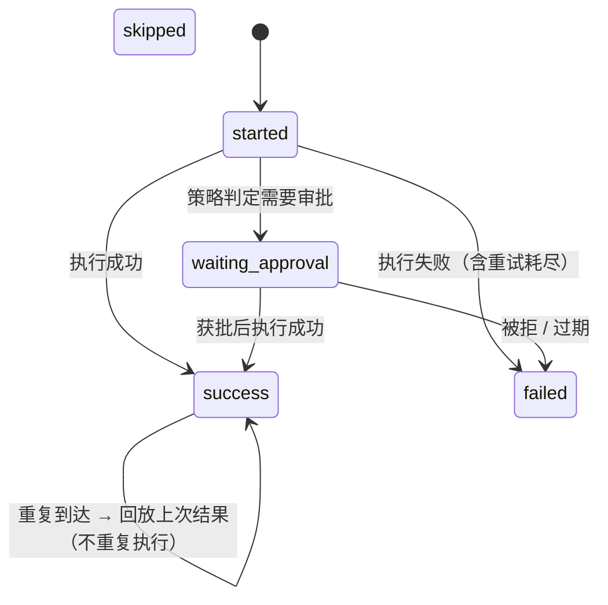
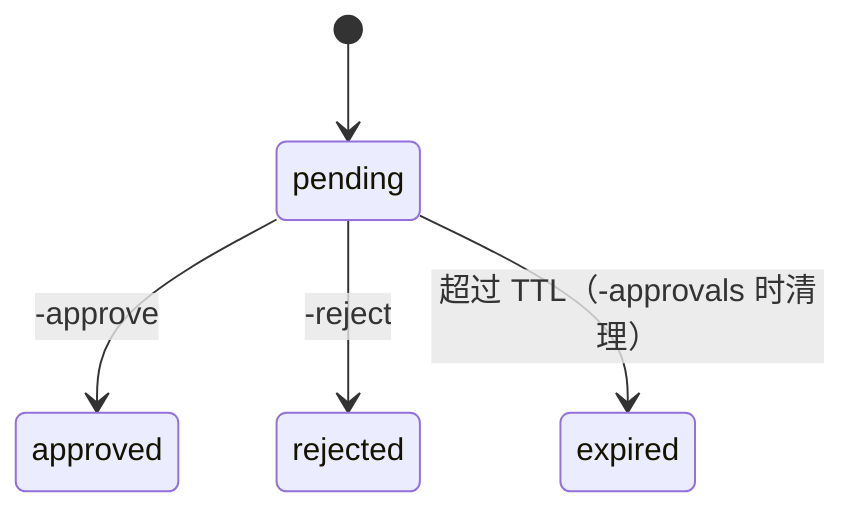

# 架构：三张图看懂 safeguard-agent

> 这个项目不是"又一个 Agent demo"。它要回答的是**上线前那些绕不开的问题**：
> 高危操作谁来批、进程挂了任务丢不丢、重试会不会把线上改两遍、评测能不能复现。
>
> 三张图分别是：**分层**（谁依赖谁）、**一次调用的控制流**（权限在哪一步生效）、
> **状态机**（挂起与恢复怎么闭环）。

---

## 图 1 · 分层与依赖方向

**这张图要说明的三件事**：

1. **依赖方向永远朝内**：`orchestrator` 不知道 MySQL，`tools` 不知道谁在调用它，
   `executor` 不知道任务是什么。每一层只依赖下一层的**接口**（`ToolRunner`、`DataSource`、`StateStore`）。
2. **权限治理是横切的双层**：`policy` 判定"要不要批"，`approval` 负责"批之前先落库"。
   它们都不碰业务参数——判定依据只有工具声明的静态属性。
3. **执行层可以脱离编排层单独测**：`executor` 的全部测试都不需要模型，
   `tools` 的测试不需要数据库。这是"能测"的前提。

> 怎么讲清楚："我用依赖方向来保证'权限不可被绕过'：模型只能通过 orchestrator 提请求，
> 而 orchestrator 在调用工具**之前**必须经过 policy 与 gate。它没有别的路可走。"

---

## 图 2 · 一次只读调用的控制流

**关键点**：`step_no` 在**执行之前**就确定了，它是幂等 key 的一部分，
也是 `task_steps` 的主键之一——三者由同一个编号串起来，这是恢复能成立的前提。

---

## 图 3 · 高危调用：挂起 → 审批 → 续跑

**这张图是项目的高光**：`-approve` 只改工单，不动执行状态（人批的是"这件事"，
而不是"这一次进程"）；`-resume` 用**原步骤号**重放，所以幂等 key 不变、
写操作不会生效两次。实测证据见 [design.md §16](design.md)。

---

## 图 4 · 状态机（三张表各自的合法迁移）

> 三张表分三张图：状态名在 `tasks` 与 `tool_calls` 里是重名的（都有 `success`/`failed`），
> 放进同一张 Mermaid 图里会被合并成同一个节点——这是画图时最容易出的错。

**`tasks`（任务）**

**`tool_calls`（执行记录，主键 = 幂等 key）**

**`approvals`（工单）**

**为什么值得画出来**：这三张表的状态迁移**都只用条件更新**实现
（`WHERE status='pending'`），所以"批两次"、"批完再拒"这类竞态在数据库层面就失败了。
挂起链路的正确性不依赖应用层的判断——这是能扛住进程重启的原因。

---

## 表结构与它们各自回答的问题

| 表 | 回答的问题 | 生命周期 |
|---|---|---|
| `tasks` | 这个任务做到哪了 | 可清理 |
| `task_steps` | 每一步做了什么、回喂了什么 | 可清理 |
| `tool_calls` | 这个操作发出去过没有、结果是什么 | 可清理 |
| `approvals` | 等谁批、批了没有 | 可清理 |
| `audit_logs` | **谁在什么时候做了什么** | **只增不删**（无外键） |
| `services` / `service_configs` / `service_metrics` | 被运维的对象（演示数据） | 可重灌 |
| `config_changes` | 下游幂等的台账（同一 key 只生效一次） | 只增 |

细节与"为什么要拆开"见 [design.md §3](design.md)。
