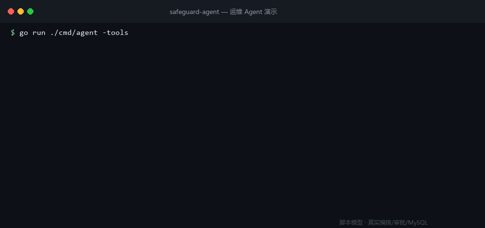

# safeguard-agent v0.1.0

> 一个**敢上生产**的运维 Agent：工具按风险分级、危险操作强制人工审批、任务断点可恢复、上下文可压缩可回查、效果可回归评测。

首个可用版本。不是"能调用工具的 demo"，而是把**权限、幂等、恢复、审计**这几件生产环境真正会要命的事做进主流程的版本。



---

## 亮点

| | |
|---|---|
| **权限不交给模型** | 工具静态声明风险等级（只读 / 写 / 高危），模型只能申请、不能批准；高危操作一律挂起等人工 |
| **重试不会做第二遍** | 幂等 key + 三段式落库（意图 → 下游 → 结果）+ 下游幂等透传；审批通过后**在原 step_no 上重放** |
| **进程随时可以死** | 工单与执行意图先落库再结束运行；`-resume` 从 `task_steps` 重建对话继续 |
| **并发恢复只有一个人执行** | 迁移 0004 的 CAS + 租约：抢到执行权的才许调下游，其余返回"处理中" |
| **变更与拒绝都留痕** | 审计先落库再执行（写不进去就拒绝变更）；任务删除后审计仍存活 |
| **间接注入有防线** | 工具结果打"不可信"标记 + 可疑指令净化 + 审计；权限层兜底 |
| **上下文撑得住** | 预算 + 可插拔压缩策略（分层/去重/失败不丢），压掉的内容可 `recall_context` 按 ref 回查 |
| **模型端点可运维** | 端点健康监控 + 调用内自动切换（粘性优先、全挂 fail-open），`-models` 随时看状态 |
| **效果可回归** | 11 道题的分层评测（规则判分决定通过率，语义判分仅参考） |

---

## 安装

下载对应平台的压缩包，解压后得到单个二进制（Windows 为 `safeguard-agent.exe`）：

| 平台 | 文件 |
|---|---|
| Linux x86_64 | `safeguard-agent_v0.1.0_linux_amd64.tar.gz` |
| Linux arm64 | `safeguard-agent_v0.1.0_linux_arm64.tar.gz` |
| macOS Intel | `safeguard-agent_v0.1.0_darwin_amd64.tar.gz` |
| macOS Apple Silicon | `safeguard-agent_v0.1.0_darwin_arm64.tar.gz` |
| Windows x86_64 | `safeguard-agent_v0.1.0_windows_amd64.zip` |

**校验和**（Linux/macOS）：

```bash
sha256sum -c SHA256SUMS --ignore-missing
```

（macOS 自带的是 `shasum -a 256`，可按 `SHA256SUMS` 里的值逐个比对。）

Windows PowerShell：

```powershell
Get-FileHash .\safeguard-agent_v0.1.0_windows_amd64.zip -Algorithm SHA256
# 与 SHA256SUMS 中对应行比对
```

```text
5a46fb1fdf3a0338d377aef03e3a24e7ea9ea17f6e41236ef94c98c7af3f2b52  safeguard-agent_v0.1.0_darwin_amd64.tar.gz
1af6ce213272ff88b4f1312502dd881e034469f83f13d99f34ad65138ef7a679  safeguard-agent_v0.1.0_darwin_arm64.tar.gz
8da31f655632933dcff46ae448e46665a5435a05ec0aadcee86a873200d32908  safeguard-agent_v0.1.0_linux_amd64.tar.gz
6e65d6773ae65b03e6f38f12da874af1d30a76714849b083936a8065ffa2b457  safeguard-agent_v0.1.0_linux_arm64.tar.gz
8ee22686df5eb230ecd47af15697fe209ce6f5e8094ac73f5eda4a42709ea75a  safeguard-agent_v0.1.0_windows_amd64.zip
```

确认版本：

```bash
./safeguard-agent -version
# safeguard-agent v0.1.0
# go go1.27.2
```

---

## 快速开始

需要一个 MySQL 8.0.16+（CHECK 约束与 `DROP CHECK` 依赖它）：

```bash
export SAFEGUARD_DB_DSN='appuser:yourpass@tcp(127.0.0.1:3306)/appdb'
export SAFEGUARD_LLM_BASE_URL='http://127.0.0.1:8080/v1'   # 任何 OpenAI 兼容端点
export SAFEGUARD_LLM_MODEL='qwen2.5-7b'

./safeguard-agent -migrate        # 建表（10 张，版本化迁移 + checksum）
./safeguard-agent -seed           # 灌示例服务目录（可重复执行）
./safeguard-agent -ask "checkout-service 最近是不是变慢了？"
```

高危操作会挂起等审批：

```bash
./safeguard-agent -ask "重启 checkout-service"   # 打印工单后退出
./safeguard-agent -approvals                     # 看工单（含人话预览）
./safeguard-agent -approve tk_xxxxxxxx           # 批准
./safeguard-agent -resume task_xxxxxxxx          # 在原 step_no 上续跑
./safeguard-agent -audit task_xxxxxxxx           # 审计链路：requested → executing → executed
```

---

## 本版验证

| 项 | 结果 |
|---|---|
| 离线测试 | `go test ./...` 全绿，23 个测试文件 |
| 真实依赖测试 | 8 个（MySQL：事务/约束/幂等/审批/审计/CAS/归档；HTTP：端点切换） |
| 评测 | 理想模型 11/11、坏模型会被判失败、陷阱题拒绝率 100% |
| 静态检查 | `gofmt` 干净、`go vet` 零告警；CI 跑同样三件事 |

---

## 已知限制（边界，不是 bug）

1. **单实例**：状态、数据源、工单都在一个 MySQL 里，没有多副本部署。
2. **回放结果没有时间戳**：模型无法判断"这是多久以前的读数"。
3. **评测集小**：11 道题证明框架跑通，不是能力基准。
4. **一次工具调用 = 一步**：`call_index` 恒为 1，一轮多调用的并发路径未验证。
5. **注入防御是规则匹配**：能挡已知句式，挡不住精心改写的注入；保证靠权限层与审计。
6. **端点健康状态只在进程内**：不持久化、不跨实例共享；重启回到首选端点。
7. **归档检索是 `LIKE` 包含匹配**：不是全文索引，数据量大需替换。

---

## 说明

- 演示 GIF 使用脚本模型（`cmd/fake-llm`）生成，保证可复现；**编排、权限、审批、幂等、审计与 MySQL 都是真实的**。
- 许可证：[MIT](../LICENSE)。
- 完整设计推演见 [design.md](design.md)，逐行代码走读见 [code-walkthrough.md](code-walkthrough.md)。
